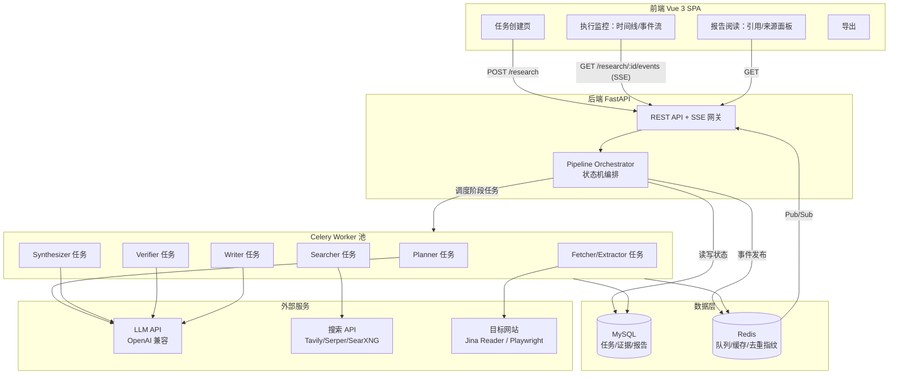
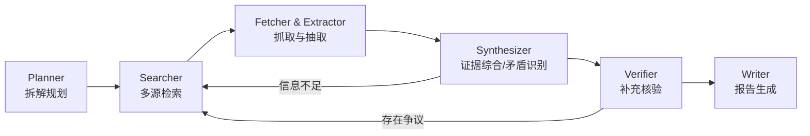

# ResearchPilot 设计文档

> 多源检索与研究报告生成平台
>
> 版本：v0.1 ｜ 日期：2026-10-15 ｜ 状态：初稿（待评审）

---

## 1. 项目概述

### 1.1 背景与定位

通用聊天式 AI 回答研究类问题时存在三个核心缺陷：**不可追溯**（不知道结论从哪来）、**易幻觉**（编造事实与出处）、**无沉淀**（回答无法导出、复用、审阅）。

ResearchPilot 的定位是一个**研究执行引擎**：用户输入研究主题（如"调研 2025–2026 年 AI Agent 在软件工程中的应用，比较主流开源项目的架构、优缺点和发展趋势"），系统自动完成"拆解 → 检索 → 抓取 → 综合 → 核验 → 写作"的完整研究流程，最终产出一篇**带行内引用、参考文献和结论、每个论断可回溯到原始来源**的研究报告。

**一句话定位**：用户看到的不是一段聊天回答，而是一份可以追溯到来源的研究报告。

### 1.2 核心用户价值

| 价值 | 说明 |
|---|---|
| 可追溯 | 报告中每条论断都带行内引用编号，点击可查看来源网页与摘录原文 |
| 过程透明 | 执行过程实时可视：拆解出哪些子问题、搜了什么、读了哪些页面、发现了哪些矛盾 |
| 结果可信 | 对关键事实做交叉核验，主动标注来源之间的矛盾与可信度 |
| 可交付 | 支持 Markdown / HTML / PDF / DOCX 导出，可直接用于汇报与归档 |

### 1.3 目标用户与典型场景

- **开发者 / 技术管理者**：技术选型调研、竞品与开源项目对比（本项目的示例场景）。
- **研究人员 / 分析师**：行业趋势、政策、市场信息的快速摸底。
- **内容创作者**：为深度文章收集素材，且需要引用出处。

### 1.4 非目标（Non-Goals）

- 不做通用聊天机器人，不支持闲聊与开放式多轮对话。
- 一期不做私有知识库 / 企业内部文档 RAG（仅公开网络来源）。
- 不追求秒级响应：一次完整研究任务是**分钟级异步作业**，用户可离开页面稍后查看。
- 一期不做用户体系的多租户隔离（单用户本地/内网部署优先）。

---

## 2. 端到端用户流程

```
用户输入研究主题
      │
      ▼
┌─────────────────────────── 系统自动执行 ───────────────────────────┐
│ ① 目标分析与子问题拆解     → 生成研究计划（子问题 + 搜索关键词）      │
│ ② 多源检索                 → 网页 / 官方文档 / 技术博客 / 论文摘要    │
│ ③ 抓取与信息抽取           → 正文提取、去重、结构化摘录               │
│ ④ 证据综合与矛盾识别       → 论断聚类、来源对比、发现冲突            │
│ ⑤ 补充检索与来源核验       → 对关键事实二次搜索、可信度评分          │
│ ⑥ 研究报告生成             → 大纲 → 章节 → 行内引用 → 结论           │
└──────────────────────────────────────────────────────────────────┘
      │
      ▼
用户查看报告：阅读正文 / 点击引用查看来源 / 查看执行时间线
      　　　　　→ 可对报告重新生成（换模型、加深度）→ 可导出 MD/HTML/PDF/DOCX
```

**示例**：输入主题"调研 2025–2026 年 AI Agent 在软件工程中的应用"，Planner 拆解为：

1. 2025–2026 年 AI Agent 在软件工程领域有哪些代表性应用形态？（编码助手、CI 修复、代码评审、测试生成…）
2. 主流开源项目（如 OpenHands、SWE-agent、Aider、AutoCodeRover 等）各自的架构是什么？
3. 这些项目在基准测试（SWE-bench 等）上的表现与优缺点对比？
4. 各项目背后的团队/公司、商业模式与发展路线？
5. 该领域公认的发展趋势与争议点是什么？

每个子问题独立走"检索 → 抽取 → 综合"，最后在报告层聚合。

---

## 3. 总体架构

### 3.1 架构图



### 3.2 模块职责

| 模块 | 职责 | 技术载体 |
|---|---|---|
| API 服务 | 任务 CRUD、SSE 进度推送、报告/来源查询、导出 | FastAPI |
| 编排器 | 驱动六阶段流水线状态机，控制预算、重试、断点续跑 | 独立 Python 模块（驻留 API 进程内） |
| 阶段 Worker | 执行具体研究动作（规划/检索/抓取/综合/核验/写作） | Celery 任务 |
| 证据库 | 存储 source / document / evidence / claim 及其关系 | MySQL + Redis 缓存 |
| 前端 | 任务创建、执行监控、报告阅读、来源追溯、导出 | Vue 3 + Vite + Element Plus + Pinia |

### 3.3 关键设计决策

| 决策 | 选择 | 理由 |
|---|---|---|
| 编排方式 | 自研轻量状态机（存 DB）而非 LangGraph | 阶段数固定、需要持久化断点续跑与前端可视化，自研更可控；LLM 调用层自行封装 |
| 任务队列 | Celery + Redis | 与既有技术栈一致；各阶段天然是异步任务，支持并发与重试 |
| 进度推送 | SSE（非 WebSocket） | 单向推送足够，实现简单、穿透代理友好 |
| 抓取 | Jina Reader（r.jina.ai）优先，Playwright 兜底动态页 | 免运维、成功率高；自建浏览器池仅作兜底 |
| LLM | OpenAI 兼容接口抽象，分级用模型 | 抽取/去重用便宜的小模型，规划/综合/写作用强模型，控制成本 |
| 搜索 | 搜索 API 适配层（Tavily / Serper / SearXNG 可插拔） | SearXNG 自托管可零成本兜底；适配层屏蔽差异 |

---

## 4. 核心流水线设计（六阶段）

流水线是一个显式状态机。一次 `research_task` 依次经过各 Stage，每个 Stage 有独立的 `stage_run` 记录（状态、输入输出摘要、耗时、token 消耗），支持整体失败后从任意阶段重跑。



### 4.1 Stage 1 — Planner（目标分析与拆解）

- **输入**：用户主题 + 可选参数（深度、范围、语言偏好、时间范围）。
- **过程**（LLM，强模型，1 次调用 + 1 次自校验）：
  1. 明确研究目标、范围边界与"完成的判据"；
  2. 拆解为 3–8 个子问题（`sub_question`），标注每个子问题的类型（事实型 / 对比型 / 趋势型）；
  3. 为每个子问题生成 2–4 条初始搜索查询（中英文双语，覆盖不同表述习惯）；
  4. 自校验：子问题合起来是否完整覆盖主题？是否存在不可检索的空泛问题？不合格则重写。
- **输出**：研究计划 JSON（子问题列表 + 初始查询集），写入 DB 并推送事件。
- **降级**：LLM 规划失败时，回退为"整句主题直接作为单一子问题"继续跑。

### 4.2 Stage 2 — Searcher（多源检索）

- **输入**：子问题及其查询集。
- **过程**：
  1. 按子问题并发调用搜索 API（每查询取 top 8–10 结果）；
  2. 来源类型打标：官方文档 / GitHub 仓库 / 技术博客 / 新闻 / 论文 / 论坛讨论，不同类型赋予不同初始可信度权重；
  3. **URL 归一化去重**（去 utm 参数、合并 http/https、strip fragment），已抓取过的 URL 直接跳过；
  4. 对每个子问题挑选 top N（默认 8–12）候选来源，写入 `source` 表，状态 `pending_fetch`。
- **输出**：候选来源列表（含标题、URL、摘要快照、类型标签）。
- **控制**：全局来源预算（默认 ≤ 60 个/任务），超出则按"子问题覆盖度 + 域名多样性"排序裁剪。

### 4.3 Stage 3 — Fetcher & Extractor（抓取与信息抽取）

- **过程**（每来源一个 Celery 子任务，并发 8–12）：
  1. **抓取**：优先 Jina Reader（返回干净 Markdown）；失败或检测到 JS 渲染页时用 Playwright 渲染后提取；记录抓取时间与快照。
  2. **三层去重**：
     - URL 级：归一化后 Redis Set 判重；
     - 内容级：正文 SimHash 指纹，汉明距离 ≤ 3 视为近似重复（对付转载/洗稿）；
     - 语义级：对跨域名高度相似的正文算 embedding 余弦相似度，> 0.95 视为同一内容（可选，控制成本）。
  3. **正文抽取**：trafilatura 提取主正文 + 发布时间 + 作者；元数据不全时用 LLM 补判。
  4. **证据摘录**（LLM，小模型）：针对所属子问题，从正文中抽取"原子证据条目"（`evidence`），每条含：原文摘录（≤ 200 字，保证可回溯）、页内位置锚点、与子问题的相关度评分（0–1）。相关度 < 0.3 的丢弃。
  5. **相关性不足处理**：正文抓到了但与子问题无关 → 标记 `irrelevant`，不进入综合。
- **输出**：每个来源的结构化证据列表；更新 `source.status`（fetched / failed / irrelevant / duplicated）。
- **重试**：抓取失败自动换通道（Jina → Playwright → 放弃），全程记录，失败不阻塞整体。

### 4.4 Stage 4 — Synthesizer（证据综合与矛盾识别）

- **输入**：某子问题下的全部证据条目（按来源分组）。
- **过程**（LLM，强模型）：
  1. **论断抽取**：将证据合并归纳为若干"论断"（`claim`），每条论断挂接支撑它的证据 ID 列表（一个论断可由多个来源共同支撑）；
  2. **论断聚类**：同主题论断聚合为"发现"（finding），形成该子问题的小结；
  3. **矛盾识别**：对比不同来源的论断，识别三类冲突：
     - **事实冲突**：A 说 X 支持 Y，B 说 X 不支持 Y（如性能数据、版本支持）；
     - **口径冲突**：统计数字/时间/名称不一致（可能是统计口径或时效差异）；
     - **观点冲突**：对同一对象评价相反（记录双方论据，不强行裁决）。
     每个矛盾生成 `contradiction` 记录，标注参与来源与冲突内容；
  4. **覆盖度评估**：对照 Planner 的"完成判据"，判断该子问题证据是否充分、有哪些信息缺口（gaps）。
- **输出**：子问题级 findings + contradictions + gaps。
- **循环**：gaps 非空且检索轮次 < 上限（默认 2 轮）→ 生成补充查询，回到 Stage 2。

### 4.5 Stage 5 — Verifier（补充检索与来源核验）

- **输入**：跨子问题筛出的**关键论断**（被报告结论依赖、或存在矛盾、或仅有单一来源支撑的论断）。
- **过程**：
  1. **补充检索**：为每条关键论断生成"独立验证查询"（换关键词、换语言、换来源类型），新增检索一轮；
  2. **交叉验证**：论断是否有 ≥ 2 个独立域名来源支撑？新增证据是支持 / 反驳 / 无关；
  3. **来源可信度评分**（对参与核验的来源）：

     | 维度 | 说明 |
     |---|---|
     | 域名权威度 | 官方文档 > 一线技术媒体 > 个人博客 > 匿名论坛 |
     | 时效性 | 发布时间与主题时间范围的贴近度 |
     | 独立性 | 是否转载/同源（与内容指纹相似度挂钩） |
     | 一致性 | 该来源的说法与多数来源的吻合程度 |

     综合得分写入 `source.credibility`，报告中据此呈现"高/中/低可信"标签；
  4. 核验后仍孤证且无法补证的论断 → 标记 `single_source`，报告中明确提示"仅单一来源，待确认"。
- **输出**：论断的核验状态（verified / corroborated / disputed / single_source）、矛盾裁决建议、更新后的可信度。

### 4.6 Stage 6 — Writer（报告生成）

- **过程**（三步走，避免长文一次生成的质量塌陷）：
  1. **大纲生成**：基于全部 findings 组织报告结构（摘要 → 背景与方法 → 分主题章节 → 对比分析 → 矛盾与争议 → 结论与展望 → 参考文献）；用户参数支持"简洁 / 标准 / 深度"三档篇幅。
  2. **逐章生成**（每章一次 LLM 调用，可并发）：
     - 硬约束：每个实质性论断后必须跟行内引用 `[n]`，引用编号必须来自其挂接的证据对应来源；禁止使用未挂接证据的论断（幻觉护栏：Writer 只能基于 claim 清单写作，写作后校验所有 `[n]` 是否存在于引用表中，非法引用自动剔除并触发该句重写）；
     - 矛盾内容按"来源 A 称…，而来源 B 认为…"的并陈方式呈现，不静默取一方；
     - 孤证论断必须带"（单一来源，待确认）"标注。
  3. **结论与摘要**：最后单独生成执行摘要与结论，明确"证据充分的高置信结论"与"存在分歧的开放问题"两类。
- **输出**：结构化报告 JSON（章节树 + 正文 + 行内引用映射）+ 渲染后的 Markdown，写入 `report` 表。
- **后处理**：参考文献表生成（编号、标题、URL、域名、发布时间、可信度标签）；报告元信息（来源数、证据数、检索轮次、耗时）。

---

## 5. 数据模型（MySQL）

### 5.1 ER 关系概览

```
research_task 1──N sub_question 1──N search_query
      │                │
      │                └──N evidence N──1 source 1──1 document
      │                     │
      │                     └──N claim_evidence N──1 claim
      │                                claim 1──N contradiction(参与方)
      └──1 report 1──N report_section
research_task 1──N stage_run 1──N event_log
```

### 5.2 核心表

```sql
-- 研究任务
research_task (
  id BIGINT PK, topic TEXT, status ENUM(pending,planning,searching,extracting,
    synthesizing,verifying,writing,done,failed,cancelled),
  params JSON,                -- 深度/语言/时间范围/篇幅/模型配置
  budget JSON,                -- max_sources/max_rounds/token 预算
  stats JSON,                 -- 来源数/证据数/耗时/token 消耗
  created_at, updated_at
)

-- 子问题
sub_question (
  id BIGINT PK, task_id FK, seq INT, content TEXT,
  type ENUM(factual, comparative, trend), status, coverage JSON, -- 完成判据与缺口
  round INT                   -- 第几轮检索产生
)

-- 搜索查询
search_query (id PK, sub_question_id FK, query TEXT, lang CHAR(2), engine VARCHAR(32),
  result_count INT, round INT)

-- 来源（搜索结果条目）
source (
  id BIGINT PK, task_id FK, url VARCHAR(2048), url_hash CHAR(64) UNIQUE,
  title VARCHAR(512), snippet TEXT, source_type ENUM(official_doc, github, blog,
    news, paper, forum), domain VARCHAR(255), published_at DATETIME NULL,
  status ENUM(pending_fetch, fetched, failed, irrelevant, duplicated),
  credibility DECIMAL(3,2),   -- 0~1
  fetch_channel VARCHAR(16),  -- jina / playwright / direct
  fetched_at DATETIME, content_simhash BIGINT
)

-- 抓取的正文
document (id PK, source_id FK UNIQUE, content MEDIUMTEXT, content_md TEXT,
  char_count INT, snapshot JSON)

-- 证据条目（可回溯的最小摘录单元）
evidence (
  id BIGINT PK, source_id FK, sub_question_id FK,
  quote TEXT,                 -- ≤200 字原文摘录
  anchor VARCHAR(255),        -- 页内定位（段落索引/标题路径）
  relevance DECIMAL(3,2),     -- 0~1
  embedding JSON NULL
)

-- 论断（综合阶段的归纳单元，写作的原子素材）
claim (
  id BIGINT PK, task_id FK, sub_question_id FK, text TEXT,
  topic_tag VARCHAR(128), verification ENUM(verified, corroborated, disputed,
    single_source, unchecked)
)
claim_evidence (claim_id FK, evidence_id FK)          -- 论断-证据挂接
contradiction (id PK, task_id FK, type ENUM(fact, caliber, opinion),
  description TEXT, claim_a_id FK, claim_b_id FK, resolution TEXT NULL)

-- 报告
report (id PK, task_id FK UNIQUE, outline JSON, content_md MEDIUMTEXT,
  sections JSON,              -- 章节树，含每章引用映射
  references JSON,            -- 编号→source_id→展示信息
  version INT, regenerated_from BIGINT NULL, created_at)
report_section (id PK, report_id FK, seq INT, heading VARCHAR(255),
  content_md MEDIUMTEXT, citation_map JSON)

-- 执行记录（驱动前端时间线）
stage_run (id PK, task_id FK, stage ENUM(planner,searcher,extractor,synthesizer,
  verifier,writer), status ENUM(running,done,failed,retrying), attempt INT,
  started_at, finished_at, summary JSON, llm_usage JSON)
event_log (id BIGINT PK, task_id FK, stage_run_id FK NULL, ts DATETIME,
  level ENUM(info,progress,warn,error), type VARCHAR(64), payload JSON)
```

**设计要点**

- `url_hash`（归一化 URL 的 SHA-256）做唯一约束，配合 Redis Set 实现抓取幂等。
- 证据到来源是强外键，报告引用链为 `报告引用编号 → source → evidence.quote`，保证任何论断两次点击内可达原文。
- `report.version` 支持重新生成保留历史版本。

---

## 6. API 设计

### 6.1 REST 接口

| 方法 | 路径 | 说明 |
|---|---|---|
| POST | `/api/research` | 创建研究任务。Body: `{topic, depth?, language?, time_range?, length?}` → `{task_id}` |
| GET | `/api/research` | 任务列表（分页） |
| GET | `/api/research/{id}` | 任务详情：状态、阶段进度、统计 |
| POST | `/api/research/{id}/cancel` | 取消任务 |
| POST | `/api/research/{id}/regenerate` | 重新生成报告。Body: `{from_stage?: "verifier"\|"writer", model?, length?}` |
| GET | `/api/research/{id}/events` | **SSE** 事件流：阶段切换、进度、告警（`text/event-stream`） |
| GET | `/api/research/{id}/report` | 报告（`version` 参数可选历史版本） |
| GET | `/api/research/{id}/plan` | 研究计划：子问题与查询 |
| GET | `/api/research/{id}/sources` | 来源列表（含可信度、状态） |
| GET | `/api/research/{id}/claims` | 论断与核验状态（矛盾清单） |
| GET | `/api/sources/{id}` | 来源详情：正文、证据摘录、引用它的报告段落 |
| GET | `/api/research/{id}/export` | 导出。`?format=md\|html\|pdf\|docx` |

### 6.2 SSE 事件格式

```json
{
  "type": "stage.update | item.update | progress | warn | done | error",
  "task_id": 123,
  "stage": "extractor",
  "data": {
    "message": "已抓取 18/42 个来源",
    "detail": {"source_id": 77, "title": "...", "status": "fetched"},
    "progress": 0.43
  },
  "ts": "2026-10-15T10:30:00+08:00"
}
```

实现：Celery 任务通过 `event_log` 落库 + Redis Pub/Sub 发布，API 层订阅后按 `task_id` 过滤推送给前端；断线重连用 `Last-Event-ID` 补发缺口（从 `event_log` 回放）。

---

## 7. 编排与可靠性设计

### 7.1 状态机编排

- Orchestrator 在 API 进程内以独立线程/asyncio task 运行，按 `research_task.status` 驱动：派发 Celery 任务 → 等待阶段完成回调 → 推进下一阶段。
- 阶段内部并行（如多来源并发抓取）用 Celery `group`/`chord`，阶段完成以 chord callback 通知 Orchestrator。
- 所有状态落 MySQL，**进程重启后可恢复**：启动时扫描 `running` 状态任务，重新入队未完成的 stage。

### 7.2 预算与止损

| 预算项 | 默认值 | 触顶行为 |
|---|---|---|
| 来源总数 | 60 | 按子问题覆盖度裁剪候选 |
| 检索轮次（gap 循环） | 2 轮 | 携带缺口直接进入写作 |
| LLM token / 任务 | 可配置（如 2M） | 后续阶段切换小模型并压缩上下文 |
| 任务总时长 | 15 min | 完成到哪一阶段就交付该阶段产物，报告标注"未完成核验" |
| 单来源抓取超时 | 30 s | 换通道，再失败标记 failed |

### 7.3 可靠性细节

- **幂等**：所有 Celery 任务以 `(task_id, stage, attempt, item_id)` 为幂等键；抓取以 `url_hash` 幂等；LLM 抽取失败重试不产生重复 evidence（先删后插）。
- **重试**：网络类错误指数退避重试 3 次；LLM 输出 JSON 解析失败 → 带错误信息重问 2 次 → 仍失败则降级跳过该条目并记 warn 事件。
- **取消**：`cancel` 置任务状态，Orchestrator 撤销后续阶段，Worker 在检查点（每条来源处理前）响应取消。
- **限流**：对搜索 API、LLM API、目标网站分别做令牌桶限流；对同一域名抓取并发 ≤ 2、间隔 ≥ 1s，降低被封风险。

---

## 8. 前端设计（Vue 3）

### 8.1 页面结构

| 页面 | 内容 |
|---|---|
| 首页 `/` | 主题输入（多行文本）+ 高级参数（深度、时间范围、语言、篇幅）+ 历史任务列表 |
| 任务页 `/research/:id` | 三栏：**左**执行时间线（阶段卡片 + 实时事件流）；**中**报告阅读（Markdown 渲染，行内引用为可点击角标）；**右**来源/证据面板（点击角标联动，展示摘录原文与跳转原链） |
| 报告全屏 `/research/:id/report` | 纯阅读模式，顶部提供导出与重新生成入口 |

### 8.2 关键交互

- **执行可视化**：SSE 驱动的时间线——每个阶段卡片显示状态（运行中转圈/完成对勾/失败警示）与关键数字（"42 个来源 / 137 条证据 / 发现 3 处矛盾"）；矛盾条目可展开查看冲突双方来源。
- **引用联动**：点击 `[n]` 角标 → 右侧面板高亮对应来源与证据摘录 → 可一键打开原始网页。
- **重新生成**：弹窗选择范围（仅重写报告 / 从核验阶段重跑）与参数（换模型、篇幅），生成后可对比历史版本。
- **导出**：MD / HTML（带样式、引用可点击）/ PDF（HTML 打印管线）/ DOCX。
- **状态管理**：Pinia store 管理任务、SSE 连接与报告数据；ECharts 呈现来源类型分布与可信度分布（任务页统计卡）。

### 8.3 组件划分（概要）

```
src/
├── views/        HomeView / ResearchView / ReportView
├── components/
│   ├── pipeline/ StageTimeline / EventStream / ProgressStat
│   ├── report/   ReportRenderer / CitationMark / ReferenceList / VersionDiff
│   ├── source/   SourcePanel / EvidenceCard / CredibilityBadge
│   └── common/   TopicInput / ParamForm / ExportMenu
├── stores/       taskStore / reportStore / sseStore
└── api/          client.ts (axios) / sse.ts (EventSource 封装)
```

---

## 9. LLM 与提示词设计

### 9.1 模型分级

| 用途 | 级别 | 说明 |
|---|---|---|
| 规划 / 综合 / 矛盾识别 / 写作 | 强模型 | 结构化推理与长文质量 |
| 证据摘录 / 相关度评分 / 补判元数据 | 小模型 | 高频调用，控成本 |
| Embedding | 向量模型 | 语义去重（可选） |

通过 `LLMClient` 抽象层统一调用 OpenAI 兼容接口（base_url / api_key / model 可配置），支持按任务参数覆盖。

### 9.2 提示词工程要点

- 所有结构化输出强制 **JSON Schema**（function calling / JSON mode），配解析失败重问；
- 抽取提示词强调"逐字摘录、不得改写、必须给页内位置"，从源头保证可回溯；
- 写作提示词只投喂 claim 清单（含证据 ID 与引用编号），并要求输出后校验引用合法性；
- 各阶段提示词集中在 `prompts/` 目录版本化管理，与代码解耦。

---

## 10. 非功能设计

- **性能**：目标一次标准任务（60 来源）端到端 ≤ 10 分钟；瓶颈在抓取与 LLM，均以并发（抓取 8–12 / 写作逐章并发）+ 缓存（同 URL 7 天内复用抓取结果，Redis TTL）压时间。
- **成本**：token 用量按任务记账（`llm_usage`），前端展示消耗；小模型承担 70% 以上调用量。
- **安全**：SSRF 防护（解析 IP，拒绝内网地址）；域名黑名单；抓取尊重 robots.txt 与限流；LLM 输出不直接执行任何代码。
- **合规**：报告只做摘录引用（≤ 200 字/条）并显著署名跳转原文；快照仅内部留存用于追溯，不对外全文展示。
- **可观测**：结构化日志（task_id 贯穿）、阶段耗时与 token 统计落库、失败事件告警。

---

## 11. 技术选型汇总

| 层 | 选型 |
|---|---|
| 前端 | Vue 3 + Vite + TypeScript + Element Plus + Pinia + Tailwind CSS + ECharts |
| 后端 | Python 3.11+ / FastAPI / SQLAlchemy 2.0 / Pydantic v2 |
| 任务队列 | Celery + Redis（broker & result backend & Pub/Sub） |
| 存储 | MySQL 8（业务数据）、Redis（缓存/指纹/去重）、本地对象存储（页面快照） |
| 抓取 | httpx + Jina Reader → Playwright（兜底）→ trafilatura 正文提取 |
| 搜索 | Tavily / Serper 适配层 + SearXNG 自托管兜底 |
| LLM | OpenAI 兼容接口（如 DeepSeek / Qwen / GLM），分级配置 |
| 导出 | markdown-it（渲染）、WeasyPrint 或 Playwright PDF（PDF）、python-docx（DOCX） |
| 部署 | docker-compose：api / worker / beat / mysql / redis / frontend（Nginx） |

---

## 12. 项目结构（后端）

```
ResearchPilot/
├── backend/
│   ├── app/
│   │   ├── main.py               # FastAPI 入口
│   │   ├── api/                  # 路由：tasks / report / sources / events / export
│   │   ├── orchestrator/         # 状态机、预算控制、恢复扫描
│   │   ├── pipeline/
│   │   │   ├── planner.py  searcher.py  fetcher.py
│   │   │   ├── extractor.py  synthesizer.py  verifier.py  writer.py
│   │   ├── llm/                  # LLMClient、模型分级、重试与 JSON 校验
│   │   ├── search/               # Tavily/Serper/SearXNG 适配层
│   │   ├── scraping/             # Jina/Playwright 抓取、正文提取、去重指纹
│   │   ├── models/               # SQLAlchemy ORM
│   │   ├── schemas/              # Pydantic
│   │   ├── events/               # event_log 落库 + Redis Pub/Sub
│   │   └── export/               # md/html/pdf/docx 渲染
│   ├── prompts/                  # 各阶段提示词模板
│   ├── celery_app.py
│   └── tests/
├── frontend/                     # Vue 3 工程（见 §8.3）
├── docker-compose.yml
└── docs/design.md
```

---

## 13. 迭代计划

| 里程碑 | 范围 | 验收标准 |
|---|---|---|
| **M1 最小闭环** | Planner → Searcher（单引擎）→ Fetcher/Extractor → Writer（简化版，无核验）；报告 Markdown + 行内引用；SSE 进度条 | 给定主题 10 分钟内产出带引用报告，引用可点开原文 |
| **M2 可信度闭环** | Synthesizer 论断/矛盾识别、Verifier 补充检索与核验、来源可信度评分、gap 循环；前端三栏任务页、来源面板 | 报告含矛盾并陈与孤证标注；关键论断 ≥2 独立来源或明确标注 |
| **M3 交付完善** | 多引擎适配、导出 PDF/DOCX、重新生成与版本对比、缓存与预算控制、docker-compose 一键部署 | 一键部署跑通全流程；导出可用；重跑不重复消耗抓取 |

---

## 14. 风险与对策

| 风险 | 影响 | 对策 |
|---|---|---|
| 反爬 / 抓取失败率高 | 来源不足，报告空洞 | 多通道抓取降级链；来源预算冗余；失败透明展示 |
| LLM 幻觉 / 编造引用 | 报告可信度崩塌 | 写作仅基于 claim 清单；引用编号后校验，非法即重写；孤证强制标注 |
| 搜索 API 配额与成本 | 任务中断或费用失控 | 适配层可切 SearXNG 自托管；任务级预算止损 |
| 内容同质化（转载洗稿） | "多来源"实为单源，核验失效 | SimHash + 语义相似度去重；可信度评分计入独立性维度 |
| 长报告质量塌陷 | 后半篇引用错乱 | 大纲→逐章生成；每章独立引用映射校验 |
| 时效敏感主题信息过时 | 结论误导 | 检索查询强制带时间限定词；展示各来源发布时间，超龄来源降权 |

---

## 15. 开放问题（待评审确定）

1. 搜索引擎默认选择：Tavily（质量好、付费）vs SearXNG 自托管（免费、需运维）？建议 M1 先接 Tavily + SearXNG 双通道。
2. 语义去重是否进入 M2（引入 embedding 服务会增加部署与成本）？
3. 报告语言策略：跟随用户输入语言，还是强制双语检索、单语输出？目前设计为"双语检索、按用户语言输出"。
4. 是否需要用户体系与任务配额（一期按单用户/内网设计，暂不做）。
5. PDF 导出采用 WeasyPrint（纯 Python、样式可控）还是 Playwright 打印（还原度高、资源占用大）？
