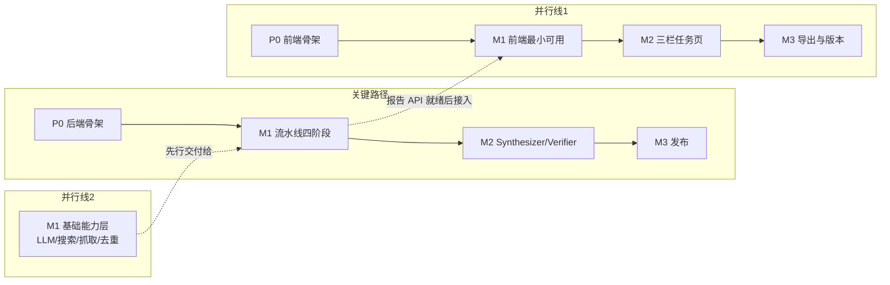

# ResearchPilot 实施计划

> 依据：[design.md](./design.md)（v0.1）｜ 状态：v0.1
>
> 说明：按工作包（WP）组织，标注依赖关系与验收标准，不含日历排期；关键路径为「后端流水线骨架」。前端可与后端并行开发（基于 Mock SSE 与 Mock API）。

---

## 1. 里程碑总览

| 里程碑 | 目标 | 核心验收（对齐设计文档 §13） |
|---|---|---|
| **P0** | 工程可运行：前后端骨架、DB 建表、队列打通、CI 就绪 | `docker-compose up` 后前后端可启动，健康检查通过，一条测试消息能走完 API → Celery → MySQL → SSE 全链路 |
| **M1** | 最小闭环：Planner → Searcher（单引擎）→ Fetcher/Extractor → Writer（简化版），报告带行内引用，SSE 进度 | 给定主题 **10 分钟内**产出带引用的 Markdown 报告，引用可点开原文 |
| **M2** | 可信度闭环：Synthesizer 论断/矛盾识别、Verifier 核验与可信度评分、gap 循环；三栏任务页 | 报告含矛盾并陈与孤证标注；关键论断 ≥2 独立来源或明确标注 |
| **M3** | 交付完善：多引擎、PDF/DOCX 导出、重生成/版本对比、缓存与预算、一键部署 | `docker-compose up` 跑通全流程；导出可用；重跑不重复消耗抓取 |

---

## 2. P0 — 工程脚手架

**目标**：把设计文档 §12 的目录结构落地为可运行空系统，基础设施全部打通。

### WP-P0.1 后端骨架

- [ ] **P0-1.1** 初始化 `backend/`：Python 3.11 + FastAPI + Pydantic v2 + SQLAlchemy 2.0，`app/main.py` 带 `/health`、CORS、结构化日志（task_id 贯穿的日志上下文）
- [ ] **P0-1.2** 全部 ORM 模型 + Alembic 迁移：`research_task / sub_question / search_query / source / document / evidence / claim / claim_evidence / contradiction / report / report_section / stage_run / event_log`（字段对齐设计文档 §5.2，含 `url_hash` 唯一约束）
- [ ] **P0-1.3** Celery 骨架：`celery_app.py`、Redis broker、`group/chord` 验证用示例任务
- [ ] **P0-1.4** 配置体系：`.env` + Pydantic Settings（DB/Redis/LLM base_url+key+模型分级/搜索 API key/预算默认值）
- [ ] **P0-1.5** `events/` 模块：`event_log` 落库 + Redis Pub/Sub 发布 + SSE 端点 `GET /api/research/{id}/events`（含 `Last-Event-ID` 回放，先按设计文档 §6.2 定好事件 schema）

### WP-P0.2 前端骨架

- [ ] **P0-2.1** Vite + Vue 3 + TS + Element Plus + Pinia + Tailwind 初始化；路由（`/`、`/research/:id`、`/research/:id/report`）
- [ ] **P0-2.2** `api/client.ts`（axios 封装）+ `api/sse.ts`（EventSource 封装，含断线重连）
- [ ] **P0-2.3** 首页静态版（主题输入 + 参数表单）+ 任务页占位

### WP-P0.3 基础设施

- [ ] **P0-3.1** `docker-compose.yml`：mysql / redis / api / worker / frontend(Nginx)，dev 与 prod 两套 profile
- [ ] **P0-3.2** lint/format（ruff + eslint/prettier）、pytest/vitest 基础配置、GitHub Actions CI（lint + test）
- [ ] **P0-3.3** 冒烟链路：`POST /api/research`（mock 模式）→ Celery 任务 → 写 DB → SSE 收到事件

**P0 完成判据**：docker-compose 一键起、迁移可执行、冒烟链路绿。

---

## 3. M1 — 最小闭环（四阶段流水线）

**范围**：Planner / Searcher（单引擎）/ Fetcher & Extractor / Writer 简化版 + 前端任务创建、进度展示、报告阅读。本里程碑**不含** Synthesizer/Verifier，Writer 直接基于证据摘录写作。

### WP-M1.1 基础能力层（并行于 WP-M1.2）

- [ ] **M1-1.1** `llm/` LLMClient：OpenAI 兼容封装、模型分级（strong/small）、JSON Schema 输出 + 解析失败重问 2 次、token 记账写 `llm_usage`
- [ ] **M1-1.2** `search/` 适配层接口 + 首个引擎实现（**Tavily**，按开放问题 Q1 结论）；来源类型打标规则（域名 → official_doc/github/blog/news/paper/forum）
- [ ] **M1-1.3** `scraping/`：Jina Reader 抓取（httpx）→ Playwright 兜底降级链；trafilatura 正文/发布时间提取；SSRF 防护与域名级限流（同域名并发 ≤2、间隔 ≥1s）
- [ ] **M1-1.4** 去重第一、二层：URL 归一化（utm/协议/fragment）+ SHA-256 `url_hash`；正文 SimHash 指纹（汉明距离 ≤3 判重）。（语义级去重留待 M2 决策，见 Q2）

### WP-M1.2 流水线阶段（关键路径）

- [ ] **M1-2.1** Orchestrator 状态机：按 `research_task.status` 驱动阶段派发与回调推进；`stage_run` 记录；取消与超时止损（任务总时长默认 15 min）；重启恢复扫描
- [ ] **M1-2.2** Planner：主题 → 3–8 子问题（类型标注）→ 每子问题 2–4 条双语查询 → 自校验重写；失败降级为单一子问题
- [ ] **M1-2.3** Searcher：按子问题并发检索、URL 归一化去重、预算裁剪（全局 ≤60 来源，按覆盖度+域名多样性）；写 `source(pending_fetch)`
- [ ] **M1-2.4** Fetcher & Extractor：per-source Celery 子任务（并发 8–12）；抓取降级链；三层去重（第一二层）；证据摘录（小模型：≤200 字逐字摘录 + 锚点 + 相关度，<0.3 丢弃，无关标 `irrelevant`）；失败不阻塞整体
- [ ] **M1-2.5** Writer 简化版：大纲 → 逐章生成（并发）→ 摘要结论；**幻觉护栏**：只投喂 evidence 清单、输出后校验 `[n]` 引用合法性、非法引用剔除重写；参考文献表生成（编号/标题/URL/域名/时间）
- [ ] **M1-2.6** `POST /api/research/{id}/cancel`、`GET /api/research`（列表分页）、`GET /api/research/{id}`（详情+统计）

### WP-M1.3 前端最小可用

- [ ] **M1-3.1** 首页：创建任务（调 `POST /api/research`）+ 历史任务列表
- [ ] **M1-3.2** 任务页简化版：阶段时间线（运行/完成/失败）+ SSE 实时事件流 + 进度数字
- [ ] **M1-3.3** 报告阅读：Markdown 渲染 + 行内 `[n]` 角标渲染为可点击 + 参考文献列表（角标点击 → 简单侧边抽屉显示来源卡片与原文跳转）

### WP-M1.4 集成验收

- [ ] **M1-4.1** 端到端脚本：以设计文档示例主题（AI Agent 在软件工程中的应用）跑通全流程
- [ ] **M1-4.2** 验收测试：10 分钟内出报告；每条论断引用可点开原文；中途 kill worker 后重启可续跑
- [ ] **M1-4.3** Prompt 版本化入库 `prompts/`（planner/extract/writer）

**M1 完成判据**：真实主题端到端出报告（≥5 个来源成功抓取、每章引用合法率 100%），SSE 进度可见，续跑验证通过。

---

## 4. M2 — 可信度闭环

**范围**：Synthesizer、Verifier、可信度体系、gap 循环；前端三栏任务页与来源面板。

### WP-M2.1 综合与核验

- [ ] **M2-1.1** Synthesizer：证据 → 论断（挂接 evidence）→ 发现聚类；三类矛盾识别（fact/caliber/opinion）写 `contradiction`；覆盖度评估产出 gaps
- [ ] **M2-1.2** gap 循环：gaps 非空且轮次 <2 → 生成补充查询回到 Searcher（Orchestrator 支持回边）
- [ ] **M2-1.3** Verifier：关键论断筛选（结论依赖/有矛盾/单源）；独立验证查询补充检索一轮；交叉验证状态机（verified/corroborated/disputed/single_source）
- [ ] **M2-1.4** 可信度评分：四维（权威度/时效性/独立性/一致性）计算写 `source.credibility`；报告中呈现高/中/低可信标签
- [ ] **M2-1.5** Writer 升级：输入升级为 claim 清单（含核验状态）；矛盾并陈句式；孤证强制标注"（单一来源，待确认）"
- [ ] **M2-1.6** （决策后）语义去重：embedding 相似度 >0.95 判重（依 Q2 结论）
- [ ] **M2-1.7** 查询接口：`/plan`、`/sources`、`/claims`、`/sources/{id}`（正文+证据+被引段落）

### WP-M2.2 前端三栏任务页

- [ ] **M2-2.1** 三栏布局：左时间线（阶段卡片+关键数字）/ 中报告 / 右来源面板
- [ ] **M2-2.2** 引用联动：点击角标 → 右栏高亮来源与证据摘录卡片（CredibilityBadge 可信标签）
- [ ] **M2-2.3** 矛盾展示：矛盾条目可展开查看冲突双方来源；计划页展示子问题与查询、核验状态
- [ ] **M2-2.4** ECharts 统计卡：来源类型分布、可信度分布

### WP-M2.3 验收

- [ ] **M2-3.1** 用含已知矛盾来源的主题做验证集：报告中出现矛盾并陈、孤证标注、可信标签
- [ ] **M2-3.2** 关键论断核验率：≥2 独立域名支撑或显式 `single_source` 标注，比例 100%

---

## 5. M3 — 交付完善

### WP-M3.1 导出与重生成

- [ ] **M3-1.1** 导出 MD / HTML（带样式、引用可点击）/ PDF / DOCX（`export/` 模块；PDF 方案按 Q5 结论，建议先 WeasyPrint）；`GET /api/research/{id}/export` + 前端 ExportMenu
- [ ] **M3-1.2** 重新生成：`POST /regenerate`（from_stage=verifier|writer、换模型/篇幅）；`report.version` 历史版本；前端版本切换与对比
- [ ] **M3-1.3** 报告全屏阅读页 `/research/:id/report`

### WP-M3.2 效率与韧性

- [ ] **M3-3.1** 多引擎适配：Serper / SearXNG（自托管兜底），按子问题/轮次路由引擎
- [ ] **M3-3.2** 缓存：同 URL 7 天抓取结果复用（Redis TTL）；预算控制全量生效（token 触顶降级小模型+压缩上下文）
- [ ] **M3-3.3** 可观测完善：阶段耗时/token 看板数据（`stage_run` 聚合）、失败告警事件

### WP-M3.3 发布

- [ ] **M3-4.1** docker-compose 生产化（prod profile：Nginx 前端静态 + API 反代、worker/beat 独立容器）、README 快速上手
- [ ] **M3-4.2** 全量回归：M1/M2 验收脚本重跑 + 导出/重生成/缓存命中验证

---

## 6. 并行与关键路径

- 前端在 M1 前期可基于 Mock SSE/JSON 开发，不阻塞于流水线进度。
- `llm/`、`search/`、`scraping/` 是流水线的直接前置，优先落地。

---

## 7. 决策点（需在设计评审后、开工前拍板）

| 编号 | 决策 | 影响范围 | 建议默认 |
|---|---|---|---|
| D1（=Q1） | 默认搜索引擎：Tavily vs SearXNG | M1-1.2、M3-3.1 | Tavily 为主，SearXNG 兜底进 M3 |
| D2（=Q2） | 语义去重是否进 M2 | M2-1.6 | 不进 M2，M3 视成本再定 |
| D3（=Q5） | PDF 导出：WeasyPrint vs Playwright | M3-1.1 | WeasyPrint 起步 |
| D4 | 具体接入的 LLM 供应商与强/小模型型号 | M1-1.1 | 任意 OpenAI 兼容端点，配置化，先不绑定 |
| D5（=Q3） | 报告语言策略 | M1-2.2/2.5 | 双语检索、按用户语言输出 |

---

## 8. 质量与测试策略

| 层 | 手段 |
|---|---|
| 单元测试 | URL 归一化、SimHash、引用校验器、可信度评分、预算裁剪（纯函数，高覆盖） |
| 契约测试 | 搜索/LLM 适配层用录制回放（vcr/cassette 风格），不打真实 API |
| 集成测试 | docker-compose 环境：mock-LLM + 本地 fixture 页面跑通流水线断言 DB 终态 |
| 端到端验收 | 每里程碑的验收脚本（§3/§4/§5 中的 M1-4、M2-3、M3-4）人工+脚本双验 |
| 回归防护 | 引用合法性校验器与"孤证标注"设为 Writer 的硬断言，测试不过不合并 |

---

## 9. 风险检查点

| 检查时机 | 检查项 | 触发动作 |
|---|---|---|
| M1 结束 | 真实抓取成功率（目标 ≥70%） | <70%：提前把 Playwright 池产品化、加大来源预算 |
| M1 结束 | 端到端耗时（目标 ≤10 min） | 超时：提高抓取/写作并发，压缩抽取上下文 |
| M2 中期 | 矛盾识别的误报率（人工抽检 20 条） | 高误报：收紧矛盾判定提示词，增加两两对比而非整批归纳 |
| M2 结束 | token 成本/任务（对齐预算默认值） | 超支：提高小模型占比、证据条数上限 |
| M3 中期 | 导出还原度（PDF/DOCX 抽检） | 不达标：PDF 切换 Playwright 打印方案（备胎预案） |

---

## 10. 首批开工清单（P0 第一批任务）

1. P0-1.4 配置体系（其他一切的前置）
2. P0-3.1 docker-compose（mysql/redis 先行）
3. P0-1.1 后端骨架 + P0-1.2 ORM 模型与迁移
4. P0-1.3 Celery 骨架 + P0-1.5 事件与 SSE
5. P0-2.1~2.3 前端骨架（并行）
